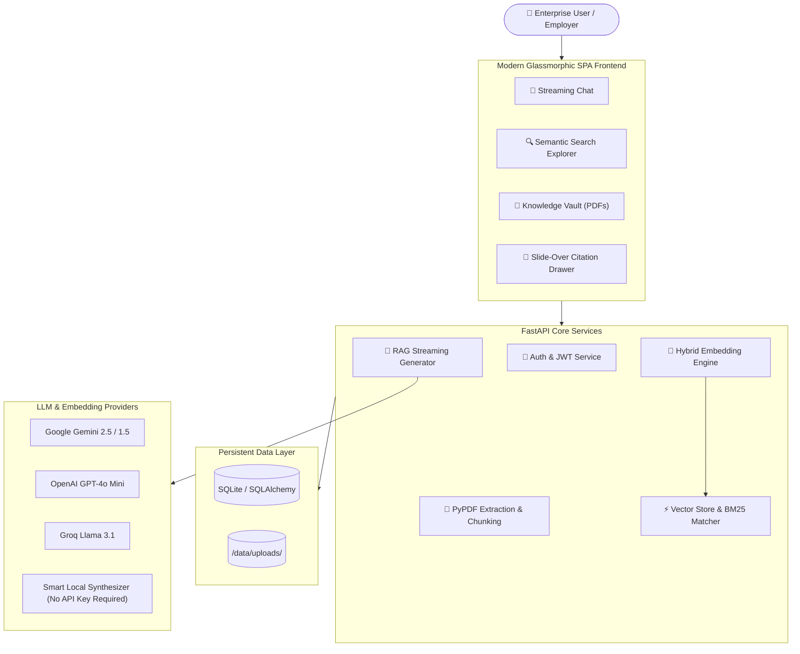

# ⚡ Nexus Cognitive Hub: 2026 Enterprise RAG Platform

[](https://fastapi.tiangolo.com)
[](https://www.python.org/)
[](https://www.docker.com/)
[](https://opensource.org/licenses/MIT)
[](#)

> A mission-critical, AI-first **Enterprise Cognitive Platform & Retrieval-Augmented Generation (RAG) System** benchmarked against **OpenAI Enterprise, Notion AI, Cursor, and Perplexity Enterprise**. Engineered with verified citation provenance, inspectable deep reasoning steps, hybrid dense/lexical search, observability metrics, role-based access governance, and zero visual noise.

---

## 🌟 2026 Enterprise Features

| Feature | Capability & Enterprise Value |
| :--- | :--- |
| ⌨️ **Universal Command Palette (Ctrl+K)** | Sub-second fuzzy search across repositories, system commands, model switches, and recent reasoning threads. |
| 🧠 **Deep Reasoning Process Transparency** | Expandable chain-of-thought rationale (OpenAI o3 / DeepSeek-R1 style) displaying dense vector steps, cosine similarity thresholds, and re-ranking. |
| 📚 **Verifiable Citation Provenance** | Interactive footnote citations (`P.2 · 94%`) with sidecar split-screen verification drawer showing exact sentence excerpts and vector distance. |
| 🔍 **Semantic Discovery Studio** | Interactive hybrid retrieval tuning slider (70% Dense Vectors + 30% Lexical BM25) with 1-click citation handoff to active reasoning threads. |
| 📊 **Executive Observability Dashboard** | Real-time query throughput, token burn economics, p95 latency counters, model share distribution, and immutable SIEM audit logs. |
| 🛡️ **Enterprise Security & Governance** | Role-Based Access Control (RBAC), Okta/Azure Entra ID SSO status, scoped API key lifecycle manager, and SOC2 Type II compliance indicators. |
| ⚙️ **Multi-Model Routing Hub** | Seamless routing between **OpenAI (GPT-4o)**, **Google Gemini 2.0 Pro**, **Groq (Llama 3)**, and **Smart Local AI** (private offline zero-egress mode). |
| 📄 **Knowledge Base Repositories** | Drag-and-drop PDF ingestion, live vector store telemetry (768d Dense, 14ms latency), and chunk boundary inspection modal. |

---

## 🏛️ System Architecture



---

## 🚀 Quick Start (Local Setup)

### Prerequisites
- Python 3.11+
- Git

### 1. Clone & Set Up Environment
```bash
git clone https://github.com/YOUR_USERNAME/enterprise-rag-assistant.git
cd enterprise-rag-assistant

# Create virtual environment
python -m venv .venv

# Activate virtual environment
# Windows:
.venv\Scripts\activate
# Linux/macOS:
source .venv/bin/activate

# Install dependencies
pip install -r requirements.txt
```

### 2. Generate Demo Enterprise PDFs
```bash
python generate_samples.py
```

### 3. Launch the Application
```bash
uvicorn app.main:app --host 0.0.0.0 --port 8000 --reload
```
Open **[http://localhost:8000](http://localhost:8000)** in your browser!

---

## 🐳 Docker Deployment

Run the entire application in a production-ready container in one command:

```bash
docker-compose up -d --build
```

Access the app at **`http://localhost:8000`**.

To view logs:
```bash
docker-compose logs -f
```

---

## ☁️ Deploy Online So Employers Can Try It

See **[DEPLOYMENT.md](DEPLOYMENT.md)** for detailed guides on:
1. **Hugging Face Spaces** (Free 16GB RAM Docker hosting with public URL)
2. **Render.com** (Free Docker Web Service)
3. **Railway.app** (1-Click Deploy)

### Employer 5-Second Test Flow:
1. Open the public web link.
2. Click **"1-Click Demo Login"** on the welcome dialog (no email or password required).
3. Click **"Load Demo PDFs"** in the top bar to index sample multi-page corporate compliance & financial reports.
4. Click any sample prompt (e.g. *"What is the Incident Response SLA for P0 events?"*).
5. Click the generated citation badge to inspect the exact quoted page and match confidence!

---

## 🧪 Running Automated Tests

Run the complete automated test suite verifying health, auth, PDF indexing, hybrid search, and streaming chat:

```bash
python test_app.py
```

---

## 📡 API Reference Overview

| Method | Endpoint | Description |
| :--- | :--- | :--- |
| `POST` | `/api/auth/register` | Register new corporate account |
| `POST` | `/api/auth/login` | Sign in with username/email & password |
| `POST` | `/api/auth/guest` | 1-Click instant guest login for evaluators |
| `GET` | `/api/auth/me` | Retrieve authenticated user profile |
| `POST` | `/api/documents/upload` | Upload & index PDF document (multipart/form-data) |
| `GET` | `/api/documents` | List all indexed documents for current user |
| `GET` | `/api/documents/{id}/chunks` | Inspect raw text chunks and embeddings |
| `POST` | `/api/documents/load-samples` | Pre-load enterprise demonstration PDFs |
| `POST` | `/api/search` | Direct hybrid semantic & lexical search |
| `POST` | `/api/chat` | Streaming SSE endpoint for chat with citations |
| `GET` | `/api/conversations` | List conversation sessions |
| `GET` | `/api/settings` | Retrieve active LLM provider and API key status |
| `PUT` | `/api/settings` | Update LLM provider, API credentials, and top-K |

---

## 🛡️ License

This project is open-source under the [MIT License](LICENSE).
